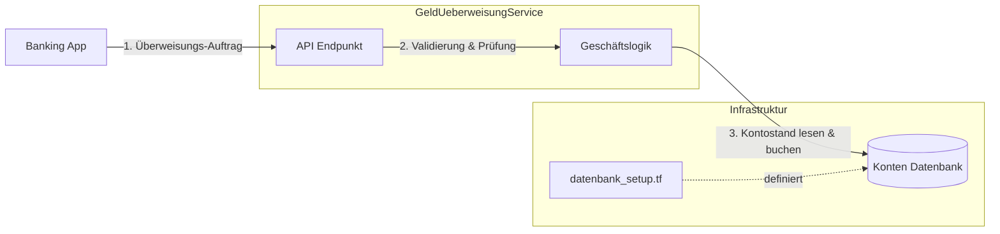
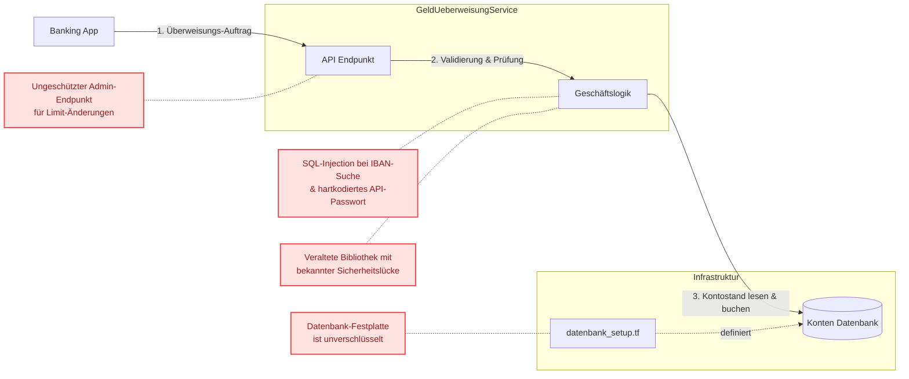

# GeldUeberweisungService (Banking DevSecOps Demo)

Ein schlanker, sofort einsatzbereiter Microservice zur Live-Demonstration des **IBM Bob DevSecOps Premium Package**.

## ⚡ Plug & Play Start (In 10 Sekunden bereit)

1. **Repository klonen und in Bob öffnen:**
   ```bash
   git clone https://github.com/roman6s/ibm-bob-devsecops-premium-package-banking-demo.git
   cd ibm-bob-devsecops-premium-package-banking-demo
   npm install
   ```
2. **Demo starten:**
   Öffne den Ordner in der Bob IDE und folge dem [**DEMO_LEITFADEN.md**](./DEMO_LEITFADEN.md).  
   *Alle Schwachstellen (SAST, Secrets, IaC, Supply Chain, Logik-Lücke) sind vorkonfiguriert und werden von Bob sofort erkannt.*

---

## 🏛️ Architektur-Übersicht

GitHub rendert diese Diagramme direkt in der Weboberfläche:

### 1. Die reguläre Microservice-Architektur


### 2. Die eingebauten Demo-Schwachstellen


---

## 📁 Projekt-Struktur

```
├── src/
│   ├── api.ts              # Express API (Überweisungen, Saldo & ungeschützter Admin-Limit-Endpunkt)
│   ├── datenbank.ts        # Kontendaten & Abfragen (enthält Demo-SQLi & Secret)
│   ├── geschaeftslogik.ts  # Überweisungslogik & SEPA-XML Parsing (veraltetes fast-xml-parser)
│   └── server.ts           # Server Bootstrap
├── test/
│   └── service.test.ts     # Unittests für Buchungsablauf & Limits
├── infra/
│   └── datenbank_setup.tf  # Terraform Konfiguration (unverschlüsselte DB)
├── Dockerfile              # Container-Definition (läuft als root)
├── DEMO_LEITFADEN.md       # 5–7 Minuten Präsentations-Leitfaden mit Klickpfaden & USPs
├── package.json            # Enthält verwundbare Abhängigkeiten (CVEs)
└── tsconfig.json           # TypeScript Konfiguration
```

---

## 🔄 Nach der Demo: 1-Klick Reset (Optional)

Falls Sie während der Live-Demo Dateien mit *"Fix with Bob"* modifiziert haben und für die nächste Präsentation wieder den Originalzustand herstellen möchten:

```bash
npm run demo:reset
```

---

## 📖 Vortrags-Leitfaden

Der vollständige Minutentakt, Klickpfade und Verkaufsargumente stehen in [`DEMO_LEITFADEN.md`](./DEMO_LEITFADEN.md).
